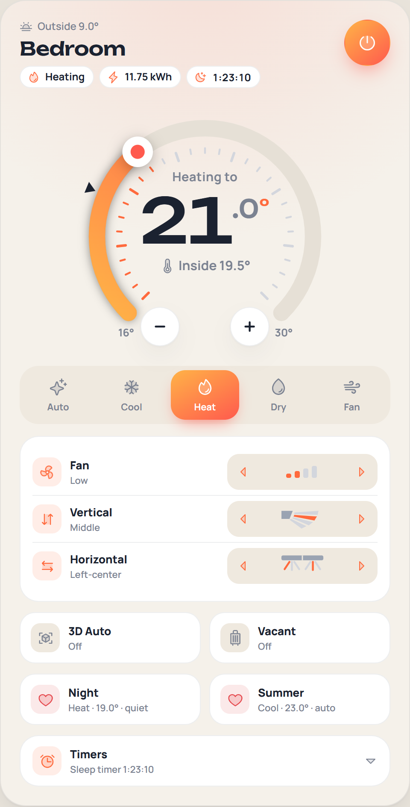
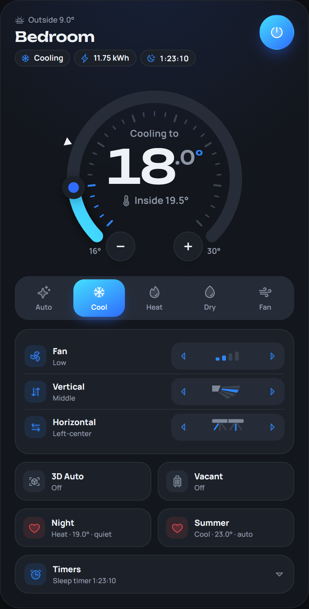
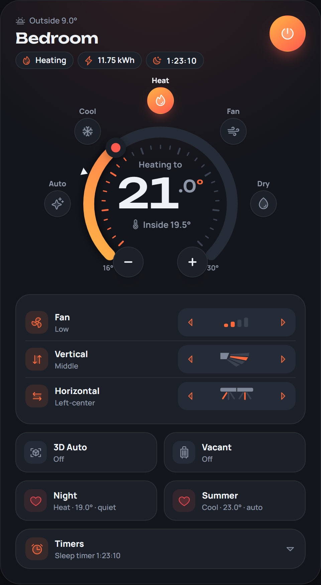
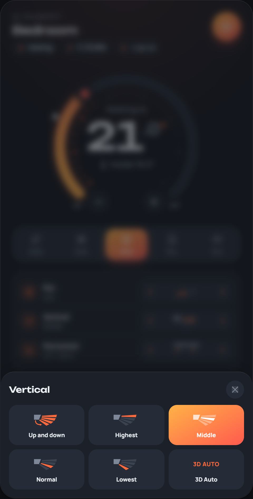
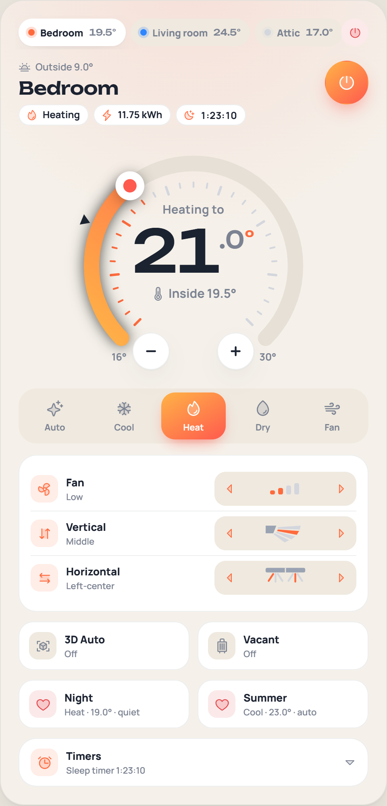
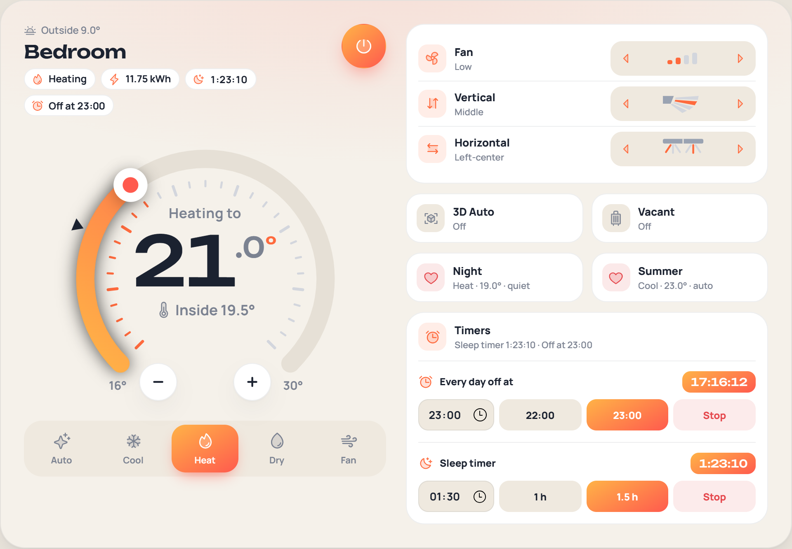

<p align="center"></p>

# Airco Commander

[](https://github.com/jonisnet/ha-airco-commander/releases)
[](https://my.home-assistant.io/redirect/hacs_repository/?owner=jonisnet&repository=ha-airco-commander&category=integration)
[](https://github.com/jonisnet/ha-airco-commander/blob/master/LICENSE)
[](https://www.home-assistant.io)
[](https://github.com/jonisnet/ha-airco-commander/releases)
[](https://github.com/jonisnet/ha-airco-commander/actions/workflows/validate.yml)
[](https://github.com/jonisnet/ha-airco-commander/actions/workflows/tests.yml)
[](https://github.com/sponsors/jonisnet)
[](https://www.buymeacoffee.com/jonisnet)

An airco card for Home Assistant in the style of the airco apps, plus the
timers those apps have: a **daily turn-off time** and a **sleep timer**. The
timers run inside Home Assistant itself, so they keep working with the
dashboard closed and survive restarts. The card ships with the integration
and is registered automatically; there are no helpers, scripts or
automations to set up.

Built around the Mitsubishi Heavy Industries WF-RAC units (Smart M-Air), via
the [Mitsubishi WF-RAC integration](https://github.com/blues-sechseck/Mitsubishi-WF-RAC-Integration),
but the card works with any `climate` entity: rows the airco does not
support are simply left out.

<p align="center">
  
  
</p>

## What you get

- **Mode ring** with Auto / Cool / Heat / Fan / Dry, the setpoint in the
  middle, and an arc that shows the room temperature heading towards it.
- **Fan speed and both louvres** as step-through pills with drawings of the
  actual louvre positions, a **3D AUTO** switch, and a **Vacant property**
  switch (the unit's own frost protection, when the unit reports it).
- **More than one airco in one card** (optional): a tab per room with a
  status dot and the room temperature, and an *All off* button.
- **Two favourites**: one tap sets mode, temperature, fan and louvres.
- **Daily turn-off time** and **sleep timer** with a live countdown.
- Drag the knob round the ring, or use − / +.
- Light and dark design; on a wide card (tablet, full-width section) the dial and
  the controls sit side by side. Dutch and English.
- Tap a pill or the temperature to choose from a sheet with every option.
- Taps are bundled before they are sent, so stepping through five fan
  speeds is one command to the unit, not five.

### Screenshots

| Mode buttons round the dial | A sheet with every louvre position | More aircos in one card |
|:---:|:---:|:---:|
|  |  |  |

On a wide card (tablet, full-width section) the dial and the controls sit side
by side:

<p align="center"></p>

## Installation

[](https://my.home-assistant.io/redirect/hacs_repository/?owner=jonisnet&repository=ha-airco-commander&category=integration)

1. **Home Assistant 2026.11 and newer:** Settings → **Marketplace** → ⋮ →
   *Add from link* → `https://github.com/jonisnet/ha-airco-commander`, type
   *Integration* (or use the button above). Older versions: the same through
   HACS → *Custom repositories*.
   While this is a beta: turn on the repository's **Pre-release** switch first.
2. Restart Home Assistant.
3. **Settings → Devices & services → Add integration → Airco Commander**,
   pick the airco, and check the linked entities it found. Other Mitsubishi
   WF-RAC aircos then show up as *Discovered*.
4. On a dashboard: **Add card → Airco Commander**.

### Full screen on a tablet: use a Sections view, not a Panel view

For a wall tablet, put the card in a **Sections** view and give it the full
width (Layout → width: full). The card switches to its side-by-side layout by
itself. Avoid a **Panel** view for now: Home Assistant loads custom cards there
without waiting for them, so after a hard refresh a panel view can show
"Configuration error" until the page is reloaded
([home-assistant/frontend#52570](https://github.com/home-assistant/frontend/issues/52570),
not something a card can fix).

The timer entities land on the airco's own device page:

| Entity | What it is |
|---|---|
| `time.<airco>_uitschakeltijd` / `turn_off_time` | Daily turn-off time |
| `switch.<airco>_vaste_uitschakeltijd` / `daily_turn_off` | Daily turn-off on/off |
| `sensor.<airco>_volgende_uitschakeling` / `next_turn_off` | Next turn-off moment (timestamp) |
| `sensor.<airco>_slaaptimer` / `sleep_timer` | End of the running sleep timer (timestamp) |

## How the timers behave

- Every change is written to disk immediately, not on a delay.
- After a restart the timers are re-armed. A timer that came due **while
  Home Assistant was down** is still carried out after startup, if it is not
  older than the catch-up window (default 120 minutes, set per airco under
  *Configure*; 0 turns catching up off).
- A turn-off that the unit did not take (the WF-RAC module refuses commands
  for a minute after the official app was used) is retried up to four times,
  75 seconds apart, until the airco reports `off`.
- Turning the airco off by any means also stops a running sleep timer (can
  be switched off per airco). The daily turn-off time keeps running.

## Actions

| Action | Fields |
|---|---|
| `airco_commander.start_sleep_timer` | `entity_id` (the climate entity), `duration` (minutes, or `1:30`) |
| `airco_commander.cancel_sleep_timer` | `entity_id` |
| `airco_commander.set_off_timer` | `entity_id`, `time` (optional, `22:00`), `enabled` (optional) |

## Card options

Everything is in the visual editor. In YAML:

```yaml
type: custom:airco-commander-card
entity: climate.living_room_airco
entities:                    # optional: more aircos, each gets a tab (+ an All off button)
  - climate.bedroom_airco
name: Living room            # optional, defaults to the entity name
outdoor_sensor: sensor.outside_temperature  # optional; found automatically for WF-RAC units
theme: auto                  # auto | light | dark
layout: auto                 # auto | stacked | wide (dial and controls side by side)
mode_style: bar              # bar | ring (mode buttons round the dial, like the app)
temp_step: 0.5               # optional: step of - and +; below 0.5 extra -1/+1 buttons appear
hide: [energy]               # modes, controls, toggles, favorites, timers, energy, outdoor
collapsible: [controls, timers]  # controls, toggles, favorites, timers - folded with a summary
off_presets: "22:00, 23:00"  # buttons for the daily turn-off time
sleep_presets: "60, 90"      # sleep timer buttons, in minutes
favorite_1:
  name: Night
  hvac_mode: heat
  temperature: 19
  fan_mode: quiet
  swing_mode: lowest
favorite_2:
  name: Summer
  hvac_mode: cool
  temperature: 23
  fan_mode: auto
  swing_mode: 3d_auto
```

## Testing the card without an airco

`dev/preview.html` is a test lab with a fake airco: themes, phone/card/tablet
widths, every mode, defrosting, unavailable, and with or without the timer
integration. Serve the repository folder (`python -m http.server`) and open
`/dev/preview.html`.

## Credits

- Fonts: [Unbounded](https://github.com/googlefonts/unbounded) and
  [Manrope](https://github.com/sharanda/manrope), SIL Open Font License,
  bundled and served by the integration itself.
- Icons: [Phosphor Icons](https://phosphoricons.com) (duotone), MIT licence.

The visual design started as a hand-built HTML/SVG layout by a Home
Assistant user who wanted the Smart M-Air app's look on his dashboard; this
project turns it into a real card.
